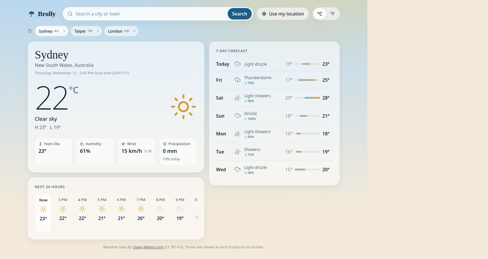
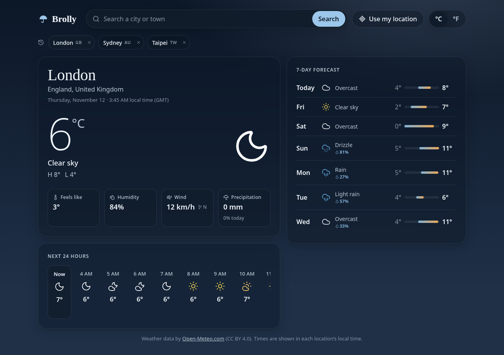
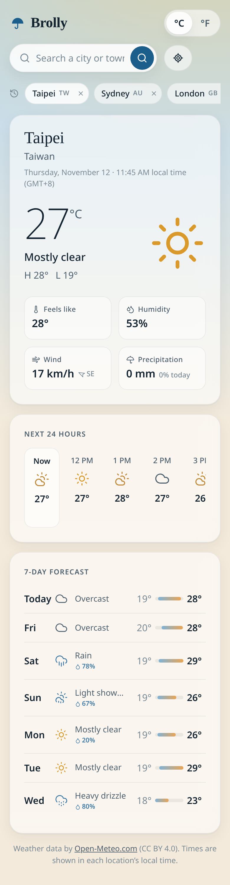

# Brolly

Frontend take-home: a weather app. Search a city (or use your current location) for current conditions, the next 24 hours, and a 7-day forecast. Data comes from [Open-Meteo](https://open-meteo.com/) — no API key needed.



 

## How to run

Node.js 18.18+ (I developed this on 24). No API key and no `.env`.

```bash
npm install
npm run dev      # http://localhost:5173
npm run build    # type-check + production build
npm test         # unit tests (Vitest)
```

## What's included

- Location search, debounced 300ms, with a keyboard-accessible suggestion list (arrow keys, Enter, Escape). If you keep typing, the previous request is cancelled so a slow response can't overwrite a newer one.
- Current conditions: temperature, weather (from the WMO code), feels-like, humidity, wind, precipitation, today's high/low, and the city's local time.
- Next 24 hours as a horizontal strip, plus a 7-day forecast.
- Loading skeletons that match the real layout, and specific error messages (offline, timeout, HTTP errors, no results, geolocation denied, and so on). A Retry button only appears when retrying might actually help.
- °C/°F (wind and precipitation switch with it: km/h↔mph, mm↔in) and recent searches, both stored in localStorage. Reloading the page brings back the last city and your unit preference.
- "Use my location" via the Geolocation API.
- Works on mobile and desktop. The background colour changes with the weather and whether it's day or night.

## Structure

```
src/
  api/         Open-Meteo client, runtime validation, WMO codes, error types
  hooks/       fetch state machine, geocoding, weather, localStorage, geolocation
  components/  one folder per component (.tsx + CSS module); mostly presentational
  types/       Place, WeatherReport, AsyncState
  styles/      design tokens and weather / day-night palettes
  utils/       unit conversion, local-time formatting
```

Only `api/` calls `fetch`. Data flows component → hook → API layer, and responses are checked at runtime before they become domain models. Swapping the weather provider would only mean changing `api/`.

`useAbortableQuery` is a small `useReducer` state machine (`idle | loading | success | error`). `useGeocoding` and `useWeather` sit on top of it. The three bits of app state — selected place, units, recent searches — live in `App.tsx` and are passed down a level or two, so I didn't add a global store.

## Why I built it this way

**Vite + React 18 + TypeScript (strict), not Next.js.** This is a client-side UI talking to a public API. It doesn't need SSR, routing, or API routes, and `npm install && npm run dev` is the least friction for a reviewer. If this later needed shareable per-city pages or a hidden API key, I'd move it to Next.js; the API layer and hooks would carry over.

**Hooks, not Redux or Zustand.** There's not enough shared state to justify a store. Remote data is a discriminated union, so a "success and error at the same time" state can't exist. If I needed caching, request deduping, or background refresh, I'd switch to TanStack Query — I kept `useAbortableQuery`'s shape close to that on purpose.

**Open-Meteo rather than a key-based API.** It's free, covers both geocoding and forecast, and the repo has no secrets, so anyone can run it straight away. The trade-offs: no alerts or historical data; conditions come as WMO codes (mapped in `api/weatherCodes.ts`); and there's no reverse geocoding, so "Use my location" shows "Your location" plus coordinates instead of a city name. I decided a second provider just for that wasn't worth it here.

**Errors.** Everything goes through `AppError` with a `kind` (`offline`, `network`, `timeout`, `http`, `invalid-response`, plus the geolocation cases). Transient failures (network, timeout, 5xx, 429) offer Retry; 4xx, a bad payload, or a denied permission don't, because retrying wouldn't help. "No results" is a successful empty response, not an error. Submitting an empty query is just form validation under the input.

**Runtime validation, not only TypeScript types.** A JSON payload can still be wrong. `validate.ts` checks the fields we care about and that Open-Meteo's column arrays are the same length. In a larger project I'd use zod; here I wanted to keep dependencies slim.

**Always fetch metric and convert on screen**, so toggling °C/°F doesn't refetch.

**Times are the location's local time.** With `timezone=auto`, Open-Meteo returns wall-clock strings with no offset, e.g. `2026-11-12T14:00`. Passing that to `new Date()` would quietly interpret it in the viewer's timezone. `utils/format.ts` treats the string as UTC and formats it with `timeZone: 'UTC'`, so the numbers on screen are the city's local time wherever you're looking from.

**CSS Modules and a handful of design tokens.** The theme is a `data-sky` attribute on `<html>` that drives CSS variables. Icons are from lucide-react.

I left out accounts, maps, a PWA, a multi-city dashboard, alerts, i18n, reverse geocoding, and component/E2E tests, to keep the scope reasonable. The unit tests cover the API layer, error types, units, and time formatting.

## Checking loading and error states

- In DevTools, throttle the network to Slow 3G, then type "Taipei" — you should see the search skeleton. Pick a city for the weather skeleton.
- Search `xqzzqk` for no results. Press Search with an empty box for the inline validation message.
- Set DevTools to Offline, then search: you should get the offline message and a "Try again" button.
- Block `api.open-meteo.com` to see a network failure.
- Deny the site's location permission, then click "Use my location".

## Notes

- Aimed at current Chrome, Edge, Firefox and Safari (`AbortSignal.any`, `AbortSignal.timeout`, CSS `color-mix`).
- UI copy is English; the brief didn't specify a language. Dates follow the browser locale.
- Open-Meteo's free tier requires attribution, which is in the footer (CC BY 4.0).

---

## 如何執行

需要 Node.js 18.18 以上，不需要 API 金鑰，也不需要 `.env`。

```bash
npm install
npm run dev    # http://localhost:5173
npm test
```

功能、架構與設計取捨請見上方英文說明。
